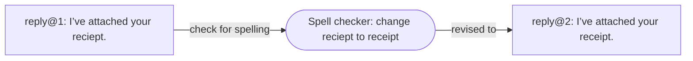

# Versions

A **version** is a record of a value at one point in its history. A customer asks for a copy of their receipt. You draft a reply: “I’ve attached your reciept.” A spell checker flags “reciept,” and you correct it to “receipt.” Strange Loop keeps both drafts.

## One item, two versions

Strange Loop calls a tracked item an **artifact**. Here, the `reply` is one artifact. Its first draft (`reply@1`) and its corrected draft (`reply@2`) are two versions of that artifact. Each version has its own ID, and Strange Loop tracks their relationship and where the change was made.

## What a version tells you

- **Value.** The value as it was when Strange Loop recorded it. For example, `Version[str]` holds a string that you can read through `.value`.
- **Origin.** Who supplied the value and which inputs were used to produce it. Following those inputs back to their sources gives you the value’s **lineage**.
- **History.** If the artifact has changed, the new version identifies its predecessor. Earlier versions keep their values and their IDs.

In [Flows and runs](flows-and-runs.md), you can see how Strange Loop records an input and how to look it up by its version ID.
