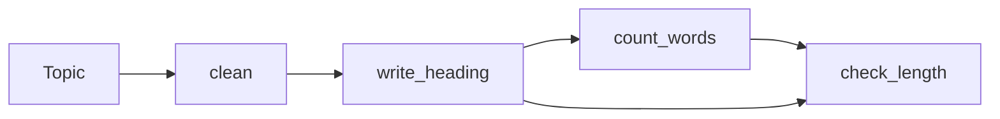
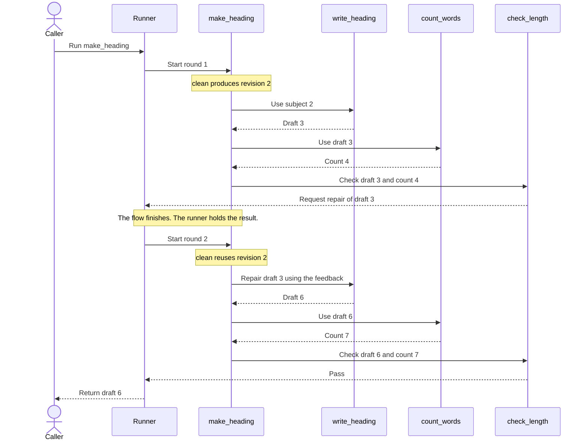

# Example — follow one repair

Suppose a flow prepares a two-word heading. The first draft says `River`. A Python stage counts one word. The grader requests a repair of the **draft**. Counting the same draft again would still give one word.

Who calls the draft stage again? **The runner starts the root flow again after the first round ends.** The flow reaches each call in the same order. At each call, the runner decides whether to reuse a revision or execute the stage.

## Read the flow from top to bottom

```python
@flow
async def make_heading(ctx, *, topic):
    subject = await clean(text=topic)
    draft = await write_heading(subject=subject)
    count = await count_words(text=draft)
    await check_length(draft=draft, count=count)
    return draft
```

Each `await` waits for that call to finish before Python continues to the next line. For example, `draft` holds a reference when `count_words` starts. The runner reads the text at that reference and passes the text to the Python stage.

The arrows below show which output each call uses. The grader needs the count to detect the error. It also needs the draft reference to identify the repair target.



Here are the stage definitions for this flow.

```python
from strange_loop import AgentStage, Pass, Repair, flow, grader, stage

write_heading = AgentStage(
    name="write_heading",
    instructions="Write a two-word heading about {subject}.",
    repair_instructions="Revise the previous heading. Use the feedback and keep the subject {subject}.",
    output=str,
)

@stage
def clean(text):
    return text.strip()

@stage
def count_words(text):
    return len(text.split())

@grader(repairable=("draft",))
def check_length(ctx, *, draft, count):
    if count == 2:
        return Pass()
    return Repair(ctx.ref("draft"), f"Expected two words. Found {count}.")
```

The first attempt uses `instructions`. A direct repair uses `repair_instructions`. If you omit the repair prompt, both attempts use `instructions`.

The trace below assumes the agent produces `River` first and `River Crossing` on repair.

## Follow the runner through two rounds



1. **Reuse the subject.** The flow calls `clean` again. The call uses the same topic reference. The runner returns the stored subject without executing the body of `clean`.
2. **Repair the draft.** The grader targeted revision 3. The runner finds the call that produced it. It sends the agent the previous draft, the subject, and the feedback. The runner stores the new draft as revision 6.
3. **Count again.** The previous count used draft 3. The current call uses draft 6. The runner detects the changed input reference and executes `count_words`.
4. **Check again.** The grader now receives a new draft and a new count. It returns `Pass()`. The runner returns draft 6 to the caller.

This rule also applies further downstream. If another stage used the count, its input would change from revision 4 to revision 7. A stage that used only the original subject could reuse its result. The runner compares revision IDs even when two revisions contain equal values.

## Inspect the stored revisions

These IDs assume a fresh in-memory store. A **slot** identifies a call within the run. Each new execution of that call writes a new revision in the same slot.

| Revision | Input or call | Stored value | Direct inputs |
|---|---|---|---|
| 1 | Run input | `" River "` | None |
| 2 | `clean` | `"River"` | `text=1` |
| 3 | `write_heading` | `"River"` | `subject=2` |
| 4 | `count_words` | `1` | `text=3` |
| 5 | `check_length` | Repair target 3 and feedback | `draft=3, count=4` |
| 6 | `write_heading` | `"River Crossing"` | `subject=2` |
| 7 | `count_words` | `2` | `text=6` |
| 8 | `check_length` | `"pass"` | `draft=6, count=7` |

The old count remains in the store. It still describes draft 3. The new count describes draft 6. The flow returns draft 6, so the caller can follow its references after the run.

For example, suppose `heading` holds the result from `await runner.run(make_heading, topic=" River ")`.

```python
runner.store.read(heading)                  # "River Crossing"
runner.store.inputs(heading)                # {"subject": Ref(id=2)}
runner.store.consumers(heading)             # Includes revisions 7 and 8
```

The runner visits the flow twice. The grader requests the repair once. The reference on each input tells the runner which stored results it can reuse.

## See what the agent receives

The adapter replaces `{subject}` with the current subject in each prompt. The agent reads the remaining instructions from the prompt and opens `/workspace/work.json`. On the repair turn, the file contains one entry.

```json
[
  {
    "output_file": "result.json",
    "previous_output": "River",
    "feedback": "Expected two words. Found 1."
  }
]
```

The agent writes the JSON string `"River Crossing"` to `result.json`. The host records the input references for that revision.
